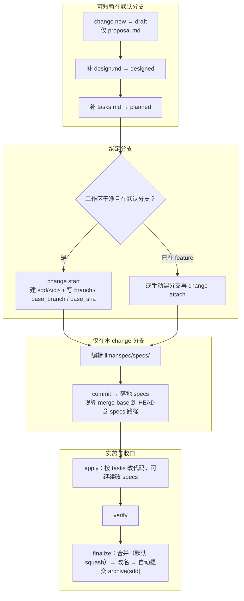

<!-- LLMANSPEC:START -->

# LLMAN 规范驱动开发

本项目使用 llman SDD。阅读 `llmanspec/config.yaml` 了解 SDD 命令行为配置，以及 `llmanspec/AGENTS.md` 获取项目附加规则。

## SDD 流水线

使用 `/llman-sdd-explore` 开始，然后按照 pipeline：`/llman-sdd-propose` → `/llman-sdd-apply` → `/llman-sdd-verify` → `/llman-sdd-archive`。

保留此托管块，便于 `llman-sdd init --update` 刷新。
<!-- LLMANSPEC:END -->

# AGENTS.md 写法

写或改本文件与 `llmanspec/AGENTS.md` 时：

| 做 | 不做 |
|----|------|
| 真需要高度注意才加粗 | 通篇加粗、emoji、生僻符号 |
| 对照用表；流程用 mermaid | 用长散文复述同一张图或表能说清的事 |
| 只写当前有效约定，描述有重心 | 墓碑（已删除 / 已移除 / 已移动 / 已废弃） |
| 数字仅当它是要守护的基准 | 会漂移的计数、扫描深度、req 编号、锁定 hash |
| 引用目录 | 钉到易搬家的具体文件 |
| 脚本用途用下面这条命令现查 | 在本文维护脚本清单 |

```text
llman tool comments overview 'scripts/**/*.{sh,py,lua,js,mjs,ts}'
```

# 可选增强能力

主流水线之外的增强。阶段内分支随对应 skill 生效；独立 skill 经 `llmanspec/config.yaml` 的 `extra_skills` 启用。

| 阶段 / skill | 能力 | 何时 |
|--------------|------|------|
| explore | grilling 逐问深对齐 | 用户说「深挖」「grill」「逐个问」「彻底理清」 |
| apply | diagnose | 自修复循环失败：先给能复现失败的命令，再排假设 |
| verify | 双轴审查 | 默认。Spec 轴对照 `.feature`；Standards 轴对照本文 coding style + Fowler smell baseline（AGENTS.md 优先；工具已强制的跳过） |
| `llman-sdd-arch-review` | 薄模块加深候选 | 「架构审查」「deepening」「shallow module」 |
| `llman-sdd-wayfinder` | 雾状工作拆成决策票 | 仅用户显式调用 |
| `llman-sdd-research` | 一手文献调研 | 后台 agent；引用回写 proposal Further Notes |

词汇（与 llman 其它词不要混用）：

| 词 | 含义 |
|----|------|
| seam | `.feature` GWT 步骤驱动的公共边界（CLI 子进程或 public 接口） |
| depth / shallow module | 接口背后藏了多少行为；薄 = 接口约等于实现 |

# Git-native 生命周期

Skill 导航（explore → propose → apply → verify → archive）不是分支生命周期。Specs landing 不是独立 skill。



硬规则：

1. **先** `change start` / `attach` 绑定非默认分支，**再**在该分支编辑并提交 `llmanspec/specs/`。禁止把 specs 提交到默认分支。
2. 无合约编辑时 frontmatter `needs_specs_change: false`。`stage=full` 且 specs-landed 门通过即可进 apply；`readyToImplement=true` 才是 verify / finalize 前置。
3. 收口用 `llman-sdd change finalize`（`--no-commit` 跳过自动提交）。change 分支上提交自由。
4. `base_sha` 只作审计；diff 范围一律现算 merge-base。`base_branch` 只解析 finalize / archive 的合并目标。

| 工作形态 | 命令 |
|----------|------|
| 单检出，在默认分支且树干净 | `llman-sdd change start <id>` |
| 保留当前检出 / 并行 change | `llman-sdd change start <id> --worktree` |
| 已在 feature 分支 | `llman-sdd change attach <id>` |

# Human Review Checkpoint

固定三个时点跑 `llman-sdd review`：apply 每批 task 门禁通过后；verify 全绿之后、建议 finalize 之前；每个 archive 之前。

非零退出 = CRITICAL：停下修复后再跑。合约争议走 explore / propose，不要现场改约定。

# Repository Guidelines

## Layout

| 目录 | 用途 |
|------|------|
| `src/` | 库与 CLI |
| `src/x/` | cursor / claude_code / codex 实验集成 |
| `src/tool/` | CLI 开发者工具 |
| `crates/llman-core/` | 共享路径与文件系统辅助（`llman::path_utils`） |
| `tests/it/` | 集成测试（单一 `it` target） |
| `tests/bdd/` | Gherkin BDD（`just bdd`） |
| `templates/` | 提示词模板 |
| `locales/` | i18n（改这里会触发重编） |
| `artifacts/testing_config_home/` | 开发命令用的测试配置根 |
| `scripts/` | 辅助脚本；用途用文首 overview 命令现查 |
| `llmanspec/` | 本仓库规格数据；llman 自身只读，由外部 llman-sdd 管理 |

## Commands

工具链：仓库锁定的 nightly 为准，不要在文档里复写 channel。完整 recipe 见 `just --list`。

| 命令 | 用途 |
|------|------|
| `just build` / `just build-release` | debug / release |
| `just run -- <args>` | 测试配置（`LLMAN_CONFIG_DIR` → `artifacts/testing_config_home/`） |
| `just run-prod -- <args>` | 生产配置 |
| `just test` | 全量测试（有 nextest 走 ci profile，否则 `cargo test`） |
| `just check` | fmt + lint + test |
| `just check-all` | check + rustdoc `-D warnings` + release + README 托管段 + bdd |
| `just bdd` | 对 `llmanspec/specs/` 中已绑定场景跑 BDD |
| `just readme` / `just check-readme` | 按 CLI `--help` 刷新 / 校验 README 托管段；改 CLI 面或版本后跑 |
| `just fmt` / `just lint` | rustfmt / clippy |
| `just release` | 打 `v<version>` tag 并推送 |

## Coding Style

- rustfmt 默认；clippy `-D warnings`（这是要守护的基准）。
- 文件与模块 `snake_case`；CLI 子命令小写，多词用连字符。
- 小函数；共享逻辑优先放 `crates/llman-core/` 与 `src/` 已有辅助，不要平行再造一套。

## Testing

- 单元测试靠近代码；集成测试放 `tests/it/`。
- 交互式 CLI（如 inquire）不强制自动化；测非交互核心逻辑。
- 开发与测试用 `LLMAN_CONFIG_DIR` 指向 `artifacts/testing_config_home/`，不要碰真实用户配置。
- 会写盘的测试必须落在 `tempfile::TempDir`（或 `TestEnvironment`）内。
- 并行测试不要用仓库根下的固定相对路径；cwd / env 变更用 `crate::test_utils::TestProcess` 护住。

## 规约入口

行为规格在 `llmanspec/specs/`，由 `llman-sdd` 读写。本仓库代码不得写入或校验该目录。

日常命令：`llman-sdd <cmd>`。`llman sdd <cmd>` 经 `llman-*` 外部子命令发现委托给 PATH 上的 `llman-sdd`，退出码透传。

## Commits and PRs

- 前缀：`feat:` / `fix:` / `refactor:` / `doc:` / `bump:`，可选 scope，如 `fix(security):`。
- 现在时、一次一事。
- PR 写清摘要、跑过的检查、相关 issue；用户可见行为变化附样例输出。

## Configuration

- 默认配置目录：`~/.config/llman/`，可被 `LLMAN_CONFIG_DIR` 覆盖。
- `LLMAN_LANG` 预留；产品文案保持 English-only，除非明确要求加语言。
